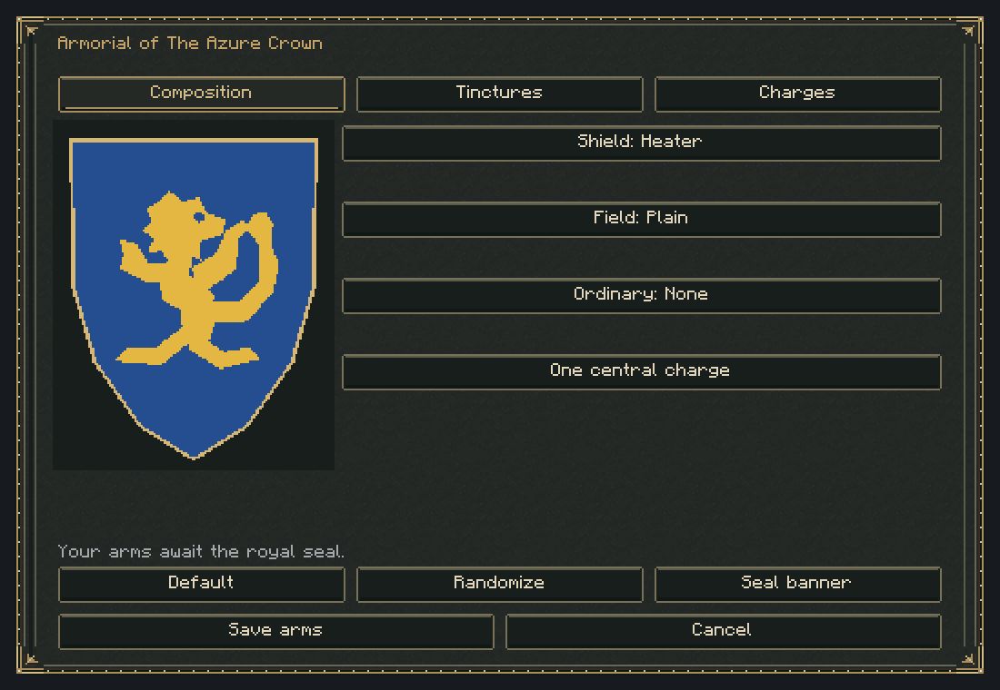
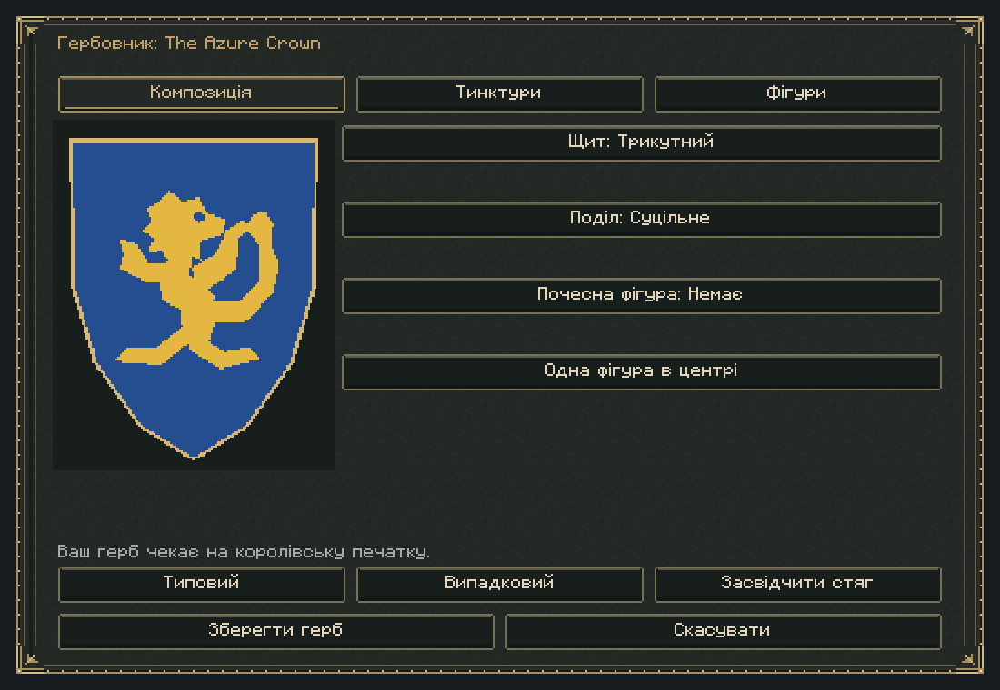
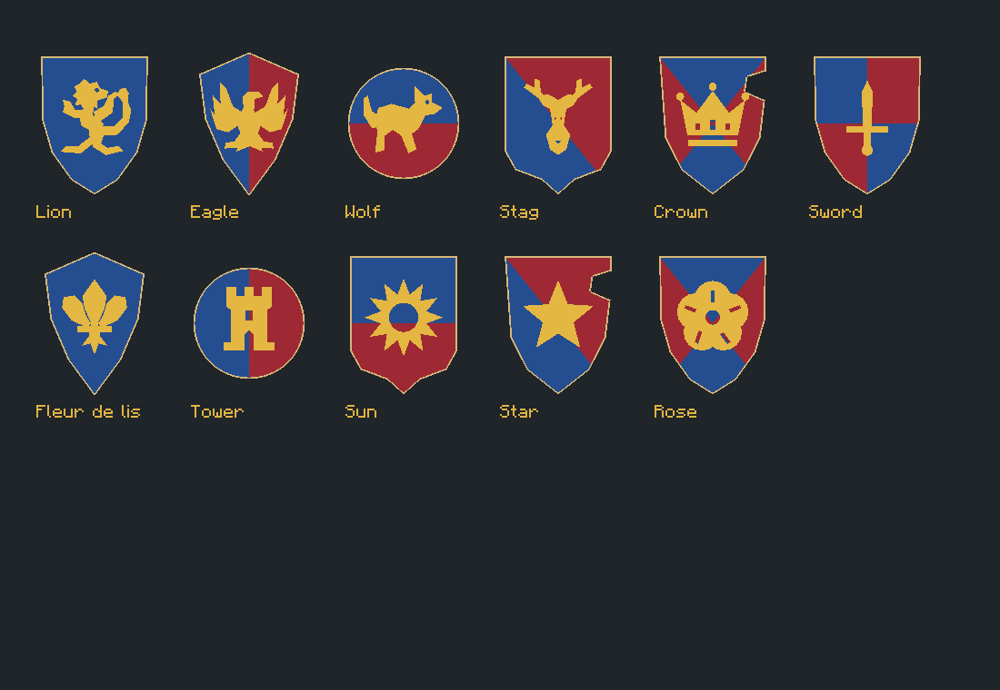
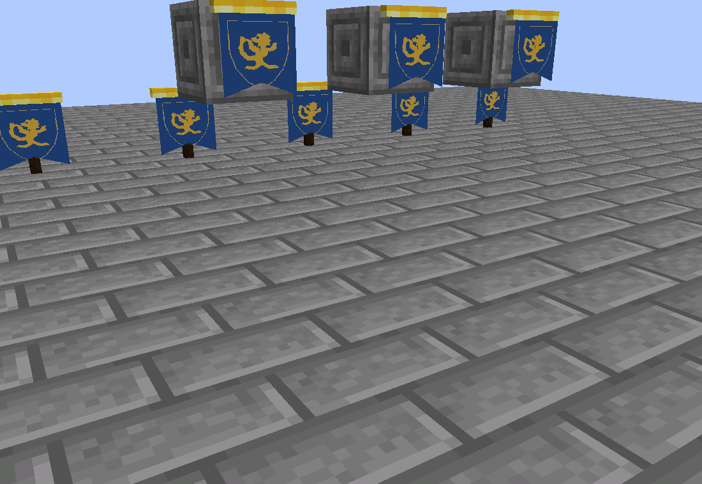
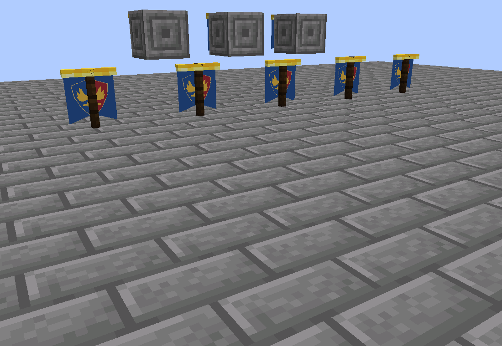

# v0.9.0 validation record

Verification performed on 2026-11-12, from feature branch
`feat/heraldry-royal-banners-v0.9.0`, based on unmerged PR #16 integration commit
`33532d6c6ddfa95580e19db16895f990724d6821`. Only Regnum Nations was changed.

| Check | Executed result |
| --- | --- |
| `./gradlew clean build --no-daemon --console=plain` | PASS: initial clean run, 212/212 required GameTests (193 existing + 19 heraldry), and 21 kingdom-name checks |
| Gameplay runtime | Java 21 (Temurin 21.0.12.1); Gradle/Loom runs on the existing JDK 25; all production classfiles target Java 21 |
| `./gradlew build --no-daemon --console=plain` | PASS: full post-review build, 213/213 GameTests (193 existing + 20 heraldry), including the post-login deletion regression |
| `./gradlew runIntegrationLayoutTest --no-daemon --console=plain` | PASS: 456 native widget layouts in English/Ukrainian at 320×240, 640×360 and 1100×760 logical sizes |
| Editor layout coverage | Three pages × zero/one/two/three charges × ruler/read-only states, sequence rejection; existing government/diplomacy/citizen layouts preserved |
| `./gradlew runHeraldryVisualTest --no-daemon --console=plain` | PASS: actual integrated client/server, real insignia packets, deterministic raster, resource reload, editor and banner framebuffer captures |
| `python3 tools/verify_heraldry_restart.py` | PASS: two normal dedicated Java 21 server processes against a disposable copy of the rendered world |
| `python3 tools/verify_mod_jar.py` | PASS: entrypoints, common/client isolation, existing obelisk adapters, new banner models/recipe, all 16 silhouettes and both locales |
| Existing obelisk validators | PASS: 7 models, 10 textures and continuous crystal clearances |
| Localization | 547 English/Ukrainian keys with matching placeholder types |
| `git diff --check` | No whitespace errors |

A regression also covers deletion as the first post-login political change after a
server restart: the server emits exactly one public tombstone.

The new GameTests exercise 2,310 combinations of shield/division/ordinary/emblem
through NBT and bounded wire serialization. Additional cases cover schema-7
migration, stable legacy defaults, rename stability, malformed/future arms recovery,
charge bounds/count, advisory tinctures, ruler/chancellor authorization and
revocation, tampered/missing/cross-world seals, actual saved-data disk restoration,
native standing/wall placement/removal/support, stable block-entity NBT, changed
arms without replacing banners, deletion/trophies, malicious item block-entity
components, allied-city protection, wilderness placement without claiming,
unauthorized/stale/replayed/concurrent/dimension-changed sessions, sealing held
blanks, oversized networking and the shared rate gate.

The client check uses the normal renderer and packets in a disposable integrated
world. Its public cache receives an initial lion design and a later eagle update;
no banners are replaced. Layout checks also exercise deletion/reset deltas. The
screenshots below were captured from the actual Minecraft framebuffer and inspected
during implementation. They are automated captures, not a claim of human gameplay
acceptance testing.

The dedicated restart script copies the completed visual world into a new
`build/run/heraldryRestart-*` directory, binds localhost on port 25589, and selects
Java 21 through a generated Loom init script. It queries standing and wall block
entity NBT, renames the kingdom, flushes saves and stops. A second fresh process
loads the same world and repeats the queries/save/stop. The NBT probe verifies
schema 8, unchanged canonical arms/UUID and unrelated collections, and the
persisted rename. The initial canonical save was schema 8; schema-7 migration and
legacy schema fixtures are verified by GameTests. Player worlds under `run/` are
never opened. The generated logs/world copies stay ignored under `build/`.

Early runs exposed a missing mock-player networking guard and two fixture
coordinates that collided with protected/other anchors. These were corrected
before the passing clean run. Visual inspection corrected camera framing and cloth
occlusion by the pole. Packaging review normalized the builtin item-model parent
to an explicit `minecraft:` identifier. Expected malformed-save fixture errors,
existing test API deprecation warnings, and this machine's missing Flite narrator
library do not indicate failed tests; audible narration was unavailable.

Not performed: two or more remote client processes, real latency/disconnect races,
human keyboard/screen-reader acceptance, survival play sessions, upgrading a copy
of a real production player world, or a large distinct-banner performance benchmark.
The in-game design uses native focus/narration and retains focus across option
changes, but these manual checks remain necessary before release acceptance.

No other Nations PR was merged/closed, and no Regnum World/Agriculture source or
dependency version was changed. See [architecture and player guide](heraldry-royal-banners.md)
for migration/rollback and the security/performance model.
