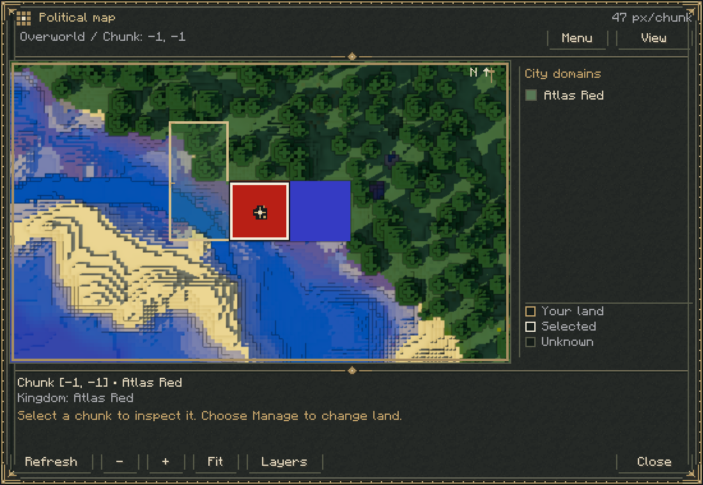
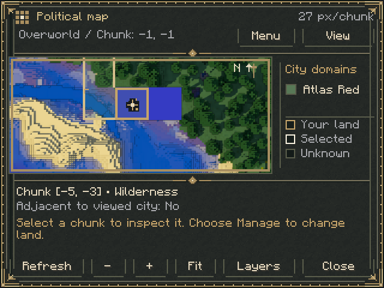
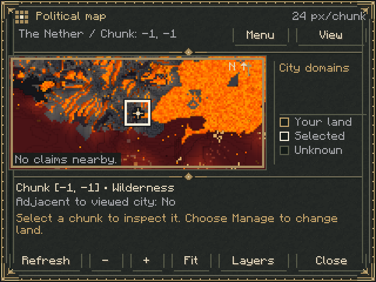

# Living Atlas terrain integration

## Technical assessment and approved approach

The user approved extracting MIT Diorama terrain code, keeping Living Atlas
top-down, and requiring no external mapping mod. Conflux code is not included.

Both repositories were cloned outside this repository under a temporary sibling
directory. Inspection covered licenses, version configurations, chunk capture,
tile composition, persistence, rendering, and GUI coupling.

| Project | Inspected revision | Finding |
| --- | --- | --- |
| Conflux Map | `a966dcf124fbfb26234f82570f710e728e946d93`, also release `v0.1.16` (`88c51a694c409076b9cee3b95a8cd0ce9fa1366c`) | GPL-3.0; explicit Fabric 1.21.1 build. |
| Diorama | `8e8a21bbf285c247298f5eb2258a1ce3928be682`, then release `v0.2.1` (`d9f4a28a3ad97c173cc78c3a747a74b083fa0c92`) | MIT; explicit Fabric 1.21.1 build using Mojang mappings, Java 21 and Fabric API `0.116.17+1.21.1`. |

**Selected source: Diorama v0.2.1.** This is an early stable release with the
1.21.1 port and the necessary terrain pipeline, before later GPU baking,
moving contraptions and additional integrations expanded its dependency graph.
The source subset will be specialized to Fabric 1.21.1 and relocated under
the Regnum Nations client package. Existing dependency versions stay fixed.

Conflux's documented `ConfluxMapApi.mapData().snapshotTile(...)` returns
asynchronous 256-pixel ARGB tiles without opening its GUI. Its pipeline uses
`ChunkCaptureService`, `TileService`, `RegionCacheService`, `RegionDiskCache`
and `TileTextureManager`; session guards isolate world/dimension data.
It supports loaded-chunk capture without a server companion; sharing and
server-wide mapping are separate server features. Its API is experimental,
published via JitPack, and supplied by the installed mod at runtime. No
separately permissive API license or linking exception was found. CC0 code can
participate in a GPL distribution, but approving that distribution is a separate
decision; it was not authorized here. This approach was stopped before copying.
See the pinned [license](https://github.com/Conflux-Union/conflux-map/blob/88c51a694c409076b9cee3b95a8cd0ce9fa1366c/LICENSE)
and [API guide](https://github.com/Conflux-Union/conflux-map/blob/88c51a694c409076b9cee3b95a8cd0ce9fa1366c/docs/api.md).

Diorama's terrain code is separable from its original Screen, although it does
not publish a standalone terrain-library API. The minimum useful source family
is `ChunkSnapshot`, `Sections`, `BlockLooks`, `BiomeTints`, `VoxelReader`,
`TileBaker`, `TileImage`, `TileKey`, `Mipmaps`, `MapLevel`, `MapTile`, and
`TileStore`, plus projection/style, coverage and texture support. These retain
snapshot sampling, terrain colors, vegetation/water blending, shading, worker
baking, partial invalidation, bounded tile caching and saved overview tiles.
No minimap, waypoint UI, radar, teleportation or seed prediction is needed.

The upstream camera is oblique: map rows depend on both elevation and Z.
Directly drawing its tiles beneath the existing square claims would misalign
terrain. The extraction will use an isolated vertical camera, including safe
zero-direction ray stepping, rather than changing an installed Diorama's global
style. The original terrain baker is reused; a new sampling engine is not needed.

The [MIT license](https://github.com/SunkenInTime/diorama/blob/v0.2.1/LICENSE)
requires retaining Dara Adedeji's copyright and permission notice. A complete
license will accompany the adapted source and be packaged in binary/source JARs;
Fabric metadata and attribution will identify the MIT subset alongside the
project's CC0 code. JSpecify nullability annotations can be removed during
specialization, avoiding an additional dependency. No Conflux, Diorama,
JourneyMap, native library, or new Gradle plugin is required at runtime.

## Integration plan

1. Extract the approved terrain subset, retaining its provenance and license;
   specialize Minecraft calls to verified local 1.21.1 mappings. Keep every
   Minecraft client reference in `src/client` and client-only mixins.
2. Capture bounded loaded chunks on the client thread and bake their copied
   snapshots on workers. Dirty hooks trigger updates; unloaded chunks are never
   force-loaded. Cache terrain separately by world and dimension, with session
   invalidation and explicit resource cleanup.
3. Draw only visible tiles inside `PoliticalMapScreen`'s scissor. Reuse its
   origin and zoom: a block spans `zoom / 16` GUI pixels. Terrain precedes
   translucent political fills, existing exterior city/kingdom borders, labels
   and selection. All layers use the same coordinate transform and rounding.
4. Preserve medieval controls, pan, zoom, ownership inspection and mutation
   permissions. Add a compact layer control. Unknown terrain stays unknown;
   political snapshot coverage is not evidence of explored terrain.
5. Add practical coordinate/cache/persistence coverage, run the complete build
   (including headless server GameTests), verify packaged metadata/notices, and
   record client checks and limitations before opening a PR against `main`.

The existing map snapshot contains claims, names and sovereignty, but no city
obelisk positions or capital flags. Exact city/capital markers need separately
bounded server-supplied data; their positions must not be guessed from arbitrary
claimed chunks or client world scanning. Existing wire identifiers/codecs and
kingdom persistence contracts must remain intact.

## Initial verification

Before implementation, `./gradlew build --no-daemon --console=plain` passed,
including all 40 required server GameTests and the kingdom-name rule checks.
This is baseline evidence only, not validation of the forthcoming terrain code.
No interactive terrain or gameplay test has been performed at this checkpoint.

## Delivered behavior

The default layer draws real explored terrain, then 20% political fills, exterior
city and kingdom borders, city/capital markers, labels, selected chunk and player
position. Layers cycles combined, political-only and terrain-only views. Panning,
cursor-anchored wheel zoom, zoom buttons, Fit and inspection use the existing
screen geometry. Adjacent chunks with the same owner have no internal border.

`AtlasTerrain` draws only visible tiles using the original chunk origin and
`zoom / 16` scale. `MapLevel` reuses upstream dirty rectangles, workers, texture
eviction and saved overview tiles. The adapter falls back to detailed tiles while
an overview is being written. GPU cache residency is capped at 64 nonempty tiles;
the snapshot cache targets 1,024 chunks, retaining unsaved chunks until their
terrain is safe to evict. Texture uploads drain at most two completions per tick.
Palette construction yields after a 2 ms budget; capture copies at most two loaded
chunks per tick with a 2 ms budget checked between chunks. These budgets do not
interrupt one individual palette operation or chunk copy. No tile baking runs in
the screen's frame loop. Dirty hooks update edited blocks and light, while a
32-position-per-tick sweep catches missed chunk-load events. No chunk is loaded or
generated by the terrain adapter, and terrain capture sends no network requests.

Cache files live under
`<game directory>/regnum-nations/atlas/v1/<world UUID>/<dimension SHA-256>/surface-90/`.
The reused OMT1 files hold compressed ABGR pixels, with saved overview pyramids.
Previously mapped pixels survive unloaded chunks and client restarts. Unknown
pixels show the atlas's charcoal background. Leaving a dimension retires the old
map, releases its GPU resources immediately and completes outstanding terrain
bakes and disk writes on a background closer. Reopening waits for that retirement
without blocking a frame. Shutdown waits for the remaining save operation.

The server supplies one opaque UUID on join, persisted separately in
`data/regnum-nations-atlas-world.dat`. This prevents same-seed worlds from sharing
terrain. Dimension IDs are hashed rather than interpreted as filesystem paths.
The additive `regnum-nations:atlas_session` channel carries only that UUID.
`regnum-nations:atlas_markers` accompanies an on-demand political snapshot and
contains at most 4,096 city IDs/positions/capital flags from its disclosed owners,
filtered to the same dimension and radius. Clients match sequence, dimension and
claimed owner before drawing markers. Existing `project-reigns:*` codecs,
registries, key bindings and schema 3 kingdom/city/claim data remain intact.

The MIT license, original copyright, source inventory and exact revision are
included in [third-party attribution](../THIRD_PARTY_NOTICES.md), the binary JAR
and the source JAR. Fabric metadata lists CC0-1.0 and MIT. Runtime and Gradle
dependency versions are unchanged; no mapping mod, library or plugin was added.

## Verification and limits

Executed on 2026-11-10:

| Check | Result |
| --- | --- |
| `./gradlew build --no-daemon --console=plain` | Passed: kingdom-name rules and all 42 required headless server GameTests, including new world-identity disk reload and bounded marker-codec checks. |
| `./gradlew runAtlasTest --no-daemon --console=plain` | Passed in a real hidden 1.21.1 client with an isolated integrated world. Checked real varied terrain, red/blue placed structures, exact vertical projection, server capital marker, negative-coordinate pan/zoom/selection, block-edit refresh, saved tile close/reload, 640x480 layout and Overworld/Nether isolation. |
| `python3 tools/verify_mod_jar.py` | Passed: packaged entrypoints/mixins, license notice, unchanged dependency set, common/client source boundary, locale parity, test exclusion and legacy resource adapters. |
| Source JAR inspection | Passed: MIT license, exact upstream revision/provenance and exclusion of test classes. |

Rendered captures were inspected for alignment and readability:

The client test is opt-in because it needs an OpenGL display. It creates new
worlds and writes captures/cache under `build/run/atlasTest/`, never player worlds
under `run/`. Detailed transient outputs are in `build/run/atlasTest/checks/`.
It is separate from the normal headless `build` checks and adds no test library.

Terrain only knows chunks the client has received; it cannot show builds or
unexplored server terrain outside that data. Political coverage is independently
bounded by the existing snapshot/radius and does not reveal terrain. Install this
build on both server and client so the cache identity and marker channels are
available. With an older server, new terrain capture waits for a trustworthy save
identity instead of risking a cache mix-up. Deleting the new identity file or the
disposable client cache loses cached exploration, not cities or claims.

Automated client checks used vanilla resources and an integrated server; a real
multiplayer client session, End/modded-dimension visuals, resource-pack reload
visuals, long-flight performance and very large display sizes were not tested.
The existing headless suite exercised dedicated-server loading and save migration;
an upgrade of a real player world still needs the existing migration procedure.
