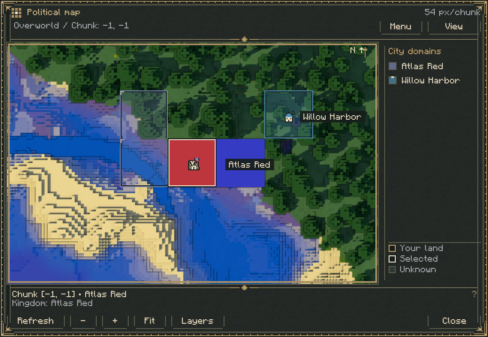
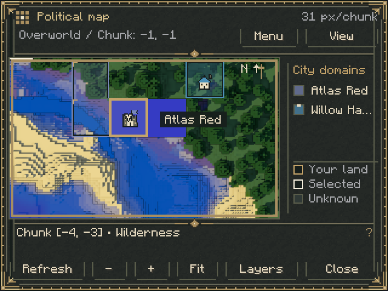
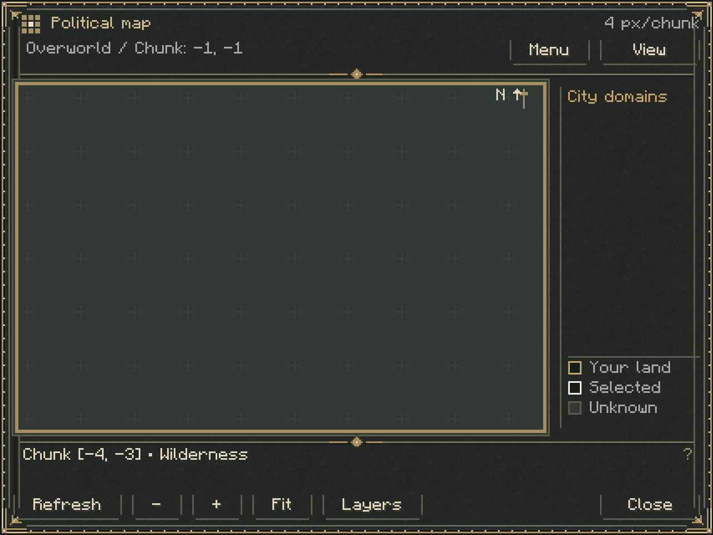
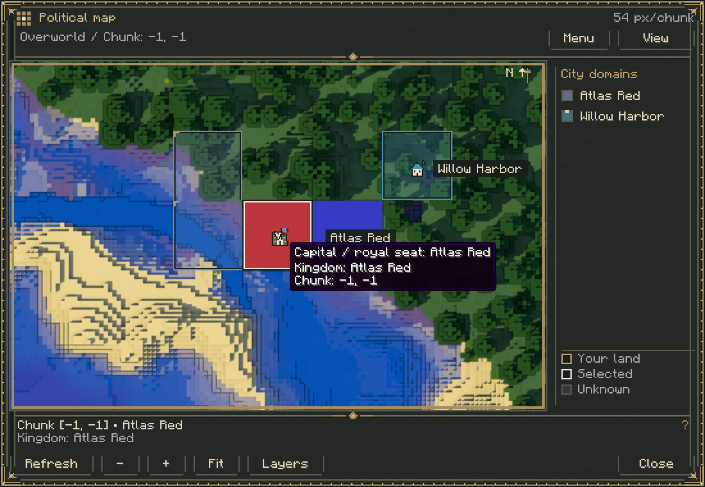
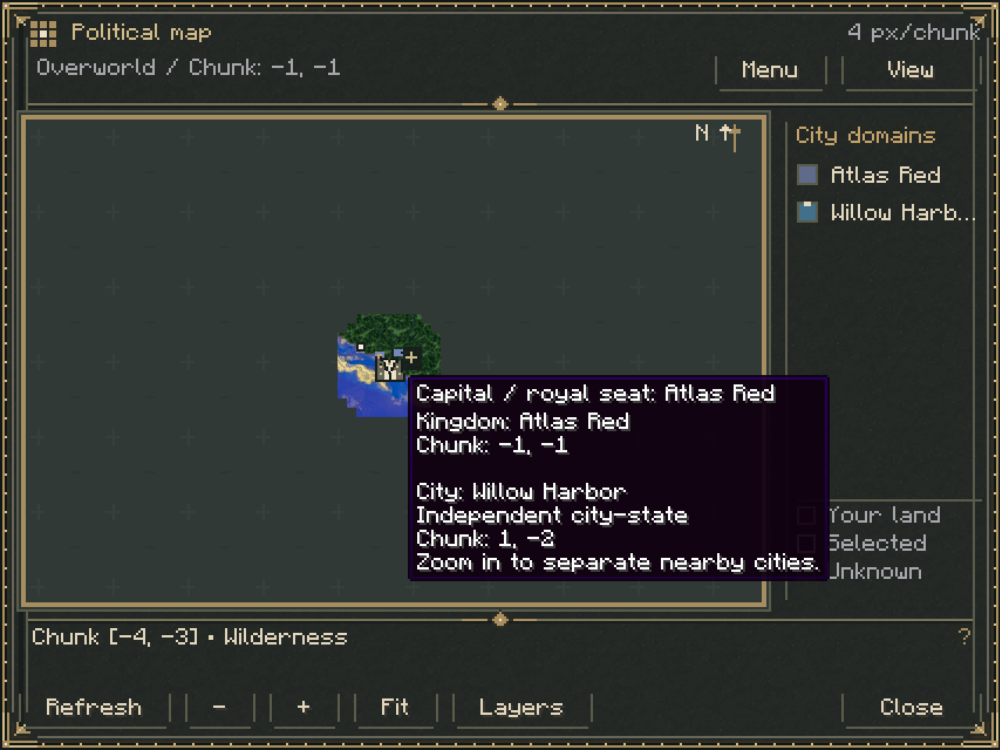
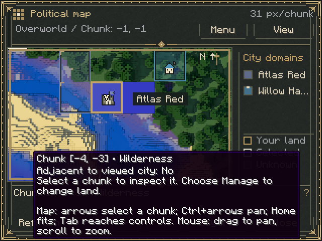

# Living Atlas UI polish

Based on the terrain implementation in PR #2 (`0d2da0d`), on the dedicated
`feat/living-atlas-ui-polish` branch. The PR targets `feat/living-atlas-terrain`
while #2 remains open; retarget to `main` after that prerequisite merges.

## Presentation

The bottom reserve shrinks from 96 to 60 logical pixels. The inspector keeps two
rows for the selected chunk coordinates, owning city, sovereignty and action
feedback. Hovering the inspector exposes complete values, adjacency and controls;
the Manage action exposes its current permission/restriction hint. Keyboard
narration retains inspection and action guidance. The Fit control also explains
mouse/keyboard navigation. The legend narrows while retaining scrolling and full
city/ownership values on hover.

Map area compared with the terrain branch at the same logical GUI dimensions:

| Logical dimensions | Typical physical size / GUI scale | Area increase |
| --- | --- | --- |
| 550 × 380 | 1100 × 760 / 2 | 23.2% |
| 320 × 240 | 640 × 480 / 2 | 40.0% |
| 427 × 320 | 1280 × 960 / 3 | 28.9% |
| 640 × 480 | 1280 × 960 / 2 | 17.2% |
| 1280 × 960 | 1280 × 960 / 1 | 7.0% |

The proportional gain is smaller when the original map already occupied most of
a large logical screen. Native controls and text retain their readable sizes.

House roofs use city/political colors. Capitals use a castle with a tinted royal
banner to identify the kingdom seat. Their 15-pixel silhouettes remain constant
across zoom levels, with ivory walls and dark outlines. Player yaw rotates a
smaller directional arrow. Labels try several bounded positions beside each city,
suppressing collisions with other labels, icons, the player chunk and compass.
Nearby pins share an icon and a `+` indicator, prioritizing capitals; hovering
lists cities, sovereignty and chunk coordinates, with a zoom-in hint. Pins retain
the exact server-provided block-centre projection, including negative coordinates;
clustering suppresses secondary icons without moving any world anchor.

Unexplored pixels expose slate-green parchment with sparse static survey hatching
beneath the existing transparent terrain tiles. Explored edges remain explicit;
no terrain is synthesized or requested. Combined-layer territory fills use 25%
opacity. Sovereign borders keep a fixed two-pixel contour with a political-color
edge and dark backing; municipal boundaries stay fine. Selected chunks use a
light wash and an ivory inset, drawn before markers and labels.

The Diorama-derived renderer, sampling, workers, caches, world/dimension handling,
server disclosure checks, claim formats and save formats are unchanged. No new
rendering dependency or shader is added. Terrain colors remain unchanged; the
optional saturation control is omitted.

## Validation

Executed on 2026-11-10:

- `./gradlew build --no-daemon --console=plain` passed during implementation.
- Final `./gradlew build runAtlasTest --no-daemon --console=plain` passed, including
  kingdom-name rules, all 42 required headless server GameTests and the real
  hidden-client checks below.
- Client checks exercised 1100×760 and 640×480 windows at GUI scale 2, plus
  1280×960 at scales 1, 2 and 3. Assertions cover viewport gain, inspector/toolbar
  separation, Manage-button bounds, exact marker anchors after negative-coordinate
  panning/zoom, low-zoom clustering and offscreen culling. Existing terrain color,
  block-edit refresh, cache close/reload, selection and dimension-isolation checks
  still pass. Native rendered tooltip captures were inspected alongside layouts.
- `python3 tools/verify_mod_jar.py` passed: packaged identity, client isolation,
  licenses, dependency set, locale parity, test exclusion and legacy resources.
- Re-running `python3 tools/generate_atlas_assets.py` produced the same sprite hash.
- `git diff --check` passed.

Client worlds and captures are disposable outputs under `build/run/atlasTest/`.
Player worlds under `run/` were not touched. The screenshots below are copied
review evidence, not runtime assets.

No interactive multiplayer gameplay, large real settlement populations, modified
resource packs, ultrawide display or production-world upgrade was tested. The
client checks use an integrated server and vanilla resources; headless GameTests
exercise server loading and persistence. Very long values can wrap in tooltips;
extremely dense clusters show a bounded subset and invite further zooming.

## Captures

Wide layout, house/castle markers and colored territory edges:

Small window with compact inspector:

Unexplored background:

Capital ownership tooltip:

Clustered city ownership:

Contextual inspection and navigation:

