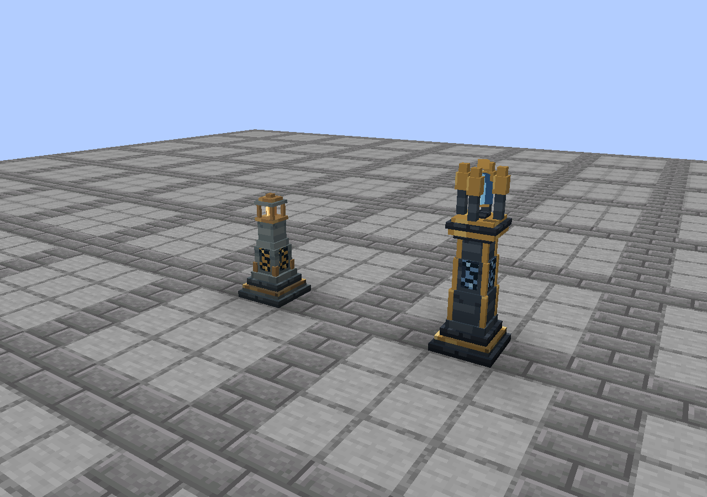

# City and Kingdom obelisk art

The City Obelisk is a two-block civic lantern monument: layered slate plinth,
stepped taper, bronze foot clasps, four inset inscriptions and an amber heart.
The Kingdom Obelisk is a 2.95-block royal monument: charcoal masonry, stepped
gold ribs, blue inscriptions, a four-prong crown and a suspended sapphire core.
Shared plinth courses, carved panels and restrained metal palettes connect them.

## Assets and rendering

| Asset | Location / behavior |
| --- | --- |
| Block models | `assets/regnum-nations/models/block/{city,kingdom}_obelisk.json` |
| Royal upper structure | `models/block/kingdom_obelisk_crown.json`, translated up 16 model units by the client renderer |
| Bright crystals | `models/block/{city,kingdom}_obelisk_glow.json`; full-bright, opaque geometry |
| Complete inventory models | `assets/regnum-nations/models/item/{city,kingdom}_obelisk.json` |
| Pixel textures | `assets/regnum-nations/textures/block/obelisk/`; five original 16×16 PNGs per monument |
| Retained registry adapters | `assets/project-reigns/blockstates/` and `assets/project-reigns/models/item/` |
| Editable sources | [`art/obelisks/`](../art/obelisks/) |

All model elements use ordinary Minecraft cuboids, explicit face UVs and supported
single-axis rotations. No transparent surfaces, animation, ticking, custom
shaders, particles or rendering dependencies are added. Stone wear uses a small
set of connected chips and seams; no random-noise texture generation is used.
The base/body faces use normal Minecraft ambient occlusion and face shading.
The crystals use bright surfaces, without casting world light.

The City model has 25 cuboids / at most 150 quads (24 cuboids chunk-baked;
one crystal rendered with its block entity). The Kingdom model has 45 cuboids /
at most 270 quads (10 cuboids chunk-baked; 33 crown/upper-body cuboids and two
crystal cuboids rendered with its existing block entity). Hidden faces are
included in these conservative counts. All textures are opaque 16×16 PNGs.

Vanilla JSON element coordinates must fit within `[-16,32]`. A base-anchored
three-block model exceeds that upper limit. Splitting the royal model at the
existing one-block shaft seam keeps every JSON valid; the client-only
`ObeliskRenderer` renders the upper JSON one block higher. The same renderer
draws the small bright crystals. Its 128-block distance limit covers several
chunks, and it permits rendering when the anchor is outside the view frustum.
Models are resolved from the current model manager so resource reloads replace
their textures correctly. Complete static item models include every part;
the royal inventory geometry is uniformly scaled by 2/3 to fit JSON bounds.

## Lifecycle and placement implications

Both remain one registered block and one existing block entity. Their full-block
base collision, selection box, placement requirements, right-click target,
mining, drops, explosion protection and relocation target remain unchanged.
Upper geometry is decorative: it has no collision, selection, extra blocks or
headroom check. Players can walk through the upper geometry, and placing under
a ceiling or putting blocks above an obelisk can intersect it. Allow two clear
blocks for a City monument and three for a Kingdom monument when decorating.
Interact with or mine the base. Relocation moves the whole visual with its
existing anchor; it needs no upper-part cleanup.

The only common-code edit adds `noOcclusion()` to the two registrations, so
neighboring faces and lighting are appropriate for the open silhouettes.
This changes their visual occlusion/light blocking, not their collision shape.
No gameplay service, block interaction/lifecycle class, block entity, NBT,
SavedData, UUID, schema, claims, citizenship, roles or permission code is changed.
Registry IDs remain `project-reigns:*`; presentation stays `regnum-nations:*`.
There is no world migration. Existing obelisks receive their new appearance.

## Editing

1. Open `art/obelisks/city_obelisk.bbmodel` or `kingdom_obelisk.bbmodel` in
   Blockbench (verified with 5.2.2). These use **Generic Model**, allowing the
   entire 48-unit royal source to be edited together.
2. Expand the numbered Foundation, Pillar, Fittings/Ribs, Inscriptions, Crown or
   Lantern, and Heart groups. Cubes are individually named. Every texture is
   embedded; opening the source needs no external image files.
3. Keep integer texel alignment where possible and preserve the existing UVs.
   Do not export the complete royal Generic Model directly as a Java block;
   its world coordinates exceed vanilla's element limit.
4. For reproducible authored exports, edit `tools/obelisk_assets.py` and run
   `python3 tools/obelisk_assets.py` (development requirement: Pillow). This
   regenerates PNGs, embedded Blockbench sources and split/static JSONs. It
   overwrites those outputs; transfer deliberate Blockbench edits into the
   authoring script first. The script is the canonical export recipe.
5. Run `python3 tools/validate_obelisk_assets.py`, then
   `./gradlew build --no-daemon --console=plain` and the client review below.
   The validator uses Python's standard library only.

## Visual review and verification

Run `./gradlew runObeliskTest --no-daemon --console=plain` with a desktop/OpenGL
session. This opt-in client mod creates a fresh world only under
`build/run/obeliskTest/`. It checks the seven baked block/item/extra models and
their sprites before and after a resource reload, then writes framebuffer
captures and a result file under `build/run/obeliskTest/checks/`. It does not
modify player worlds under `run/` and is not packaged in the release JAR.

Actual 1.21.1 client captures reviewed during this change:

- [Daylight, front](images/obelisks/day-front.png) and
  [rear](images/obelisks/day-rear.png): proportions, matching palettes, four-sided
  inscriptions, stepped silhouettes and complete geometry.
- [Night](images/obelisks/night.png): amber and blue hearts stay visible while
  stone and metal receive ordinary world lighting.
- [48-block distance](images/obelisks/distance-48.png), at the standard 70° FOV:
  City lantern and taller
  royal crown remain distinguishable; carved detail naturally becomes small.
- [Inventory](images/obelisks/inventory.png): actual baked items enlarged for
  review, with native 16-pixel icons below. Both include the complete monuments.
- [After resource reload](images/obelisks/after-reload.png): no missing sprites
  or stale atlas references; this frame matches the daylight capture exactly.
- Native Blockbench source renders:
  [City](images/obelisks/blockbench-city.png),
  [Kingdom](images/obelisks/blockbench-kingdom.png). Both opened with all five
  embedded textures reporting no errors and all named groups present.

Two visual passes corrected embedded gold ribs, the crown's diagonal occlusion
of the sapphire in inventory, the item viewing angle, and the brightest blue
highlight. The concept image in `art/obelisks/` is explicitly an AI art reference;
the screenshots above show the implemented geometry and textures.

Asset validation checks all seven JSONs, ten texture paths/dimensions, face UV
ranges, coordinate and rotation limits, retained blockstate/item adapters, group
membership and the exact embedded Blockbench textures. On 2026-11-11,
`python3 tools/validate_obelisk_assets.py` passed;
`./gradlew build --no-daemon --console=plain` passed, including the kingdom-name
rule checks and **all 96 required headless server GameTests**;
`./gradlew runObeliskTest --no-daemon --console=plain` passed the real-client
checks described above. The test harness is absent from the release JAR.

The existing Loom 1.19.4 plugin requires a Java 25 Gradle runtime here; Java 21
initially failed at plugin resolution. Java compilation remains targeted at 21.
No dependency or version was changed. Client runs reported the environment's
missing optional Linux narrator library and a vanilla shader-sampler warning;
the captures and resource checks completed successfully.

Limits: no real-player multiplayer session, production-world upgrade, shader
pack compatibility test or mass-obelisk performance benchmark was performed.
The client capture world is an automated integrated-server review, alongside
the existing dedicated headless server GameTests.

## Branch scope

At branch creation PR #6 targeted `main`, PR #7 targeted citizenship, and PR #8
(`feat/obelisk-relocation-v0.8`) targeted roles. This branch starts at PR #8's
`fd910bb` and targets `feat/obelisk-relocation-v0.8`. Work occurred in a separate
worktree; the uncommitted Citizen Management UI branch was left untouched.
